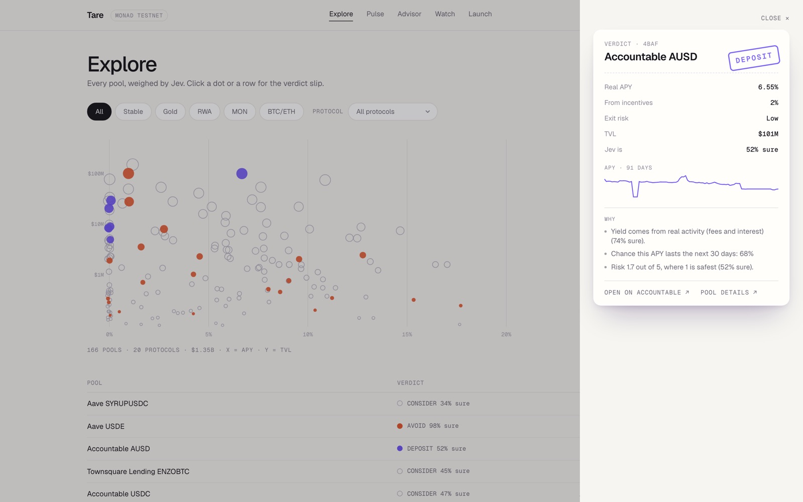
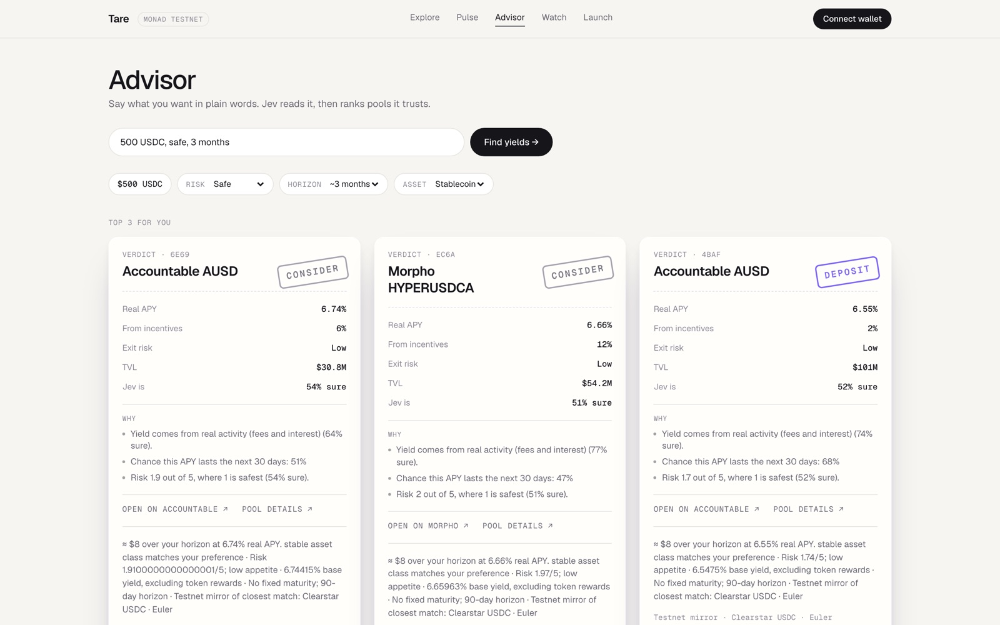
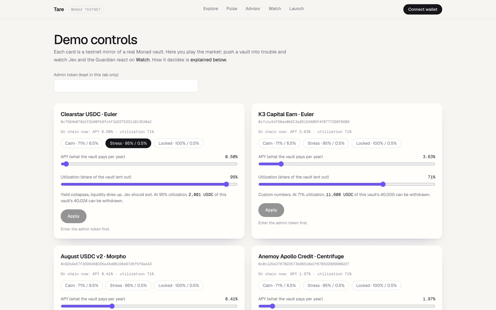

# Tare

**Every yield on Monad, weighed.**

Tare reads every yield on Monad, uses Jev (TypeSafe's System One model) to judge which ones are real, helps you deposit into the right one, and can automatically pull you out when a vault turns risky.


## Live

| | |
|---|---|
| Live app | https://tarefi.xyz |
| Hosting | Vercel (custom domain, HTTPS) |
| User transactions | Monad Testnet (chain 10143) |
| Read-only data and mirrored deploy | Monad Mainnet (chain 143) |
| Repo | https://github.com/0xGanadhish/tare |

All deposits, exits and launches are real transactions on Monad Testnet. Mainnet is used only for market data and wallet scans, plus a mirrored, source-verified contract deploy (table below).

**What runs where.** tarefi.xyz runs Explore, Pulse, the idle scan, the Advisor (live Jev), and every wallet action on testnet: test USDC faucet, deposit, autopilot on/off, withdraw, token launch and trading. The watcher that re-judges positions and triggers the Guardian is a long-running process, and the demo controls need the operator key, so both run on the demo machine (`pnpm worker`, see [Full setup](#full-setup)), not on Vercel.

**A real autopilot exit**, triggered by Jev at 94% confidence and confirmed in 2.2 s: [`0x22d5ffad…2abb4`](https://testnet.monadvision.com/tx/0x22d5ffad10ba384975565640eca72fa39de616538283f436405162b43172abb4) (block 69,803,719).

## Deployed contracts

### Monad Testnet (chain 10143), source verified

| Contract | Address | Explorer |
|---|---|---|
| MockUSDC (6 decimals, open mint) | `0xd535a4068265b383976d92718e3E650b5183b6Ab` | [MonadVision](https://testnet.monadvision.com/address/0xd535a4068265b383976d92718e3e650b5183b6ab) · [Monadscan](https://testnet.monadscan.com/address/0xd535a4068265b383976d92718e3e650b5183b6ab) |
| Guardian (keeper-gated auto-exit) | `0x0F22A6b6E5FB8bda0e85e5034DEaC069c8d5e8DF` | [MonadVision](https://testnet.monadvision.com/address/0x0f22a6b6e5fb8bda0e85e5034deac069c8d5e8df) · [Monadscan](https://testnet.monadscan.com/address/0x0f22a6b6e5fb8bda0e85e5034deac069c8d5e8df) |
| MirrorVault: Clearstar USDC · Euler | `0x7504b078d1F2b90fb9fcAf3d22753311013EA0aC` | [MonadVision](https://testnet.monadvision.com/address/0x7504b078d1f2b90fb9fcaf3d22753311013ea0ac) · [Monadscan](https://testnet.monadscan.com/address/0x7504b078d1f2b90fb9fcaf3d22753311013ea0ac) |
| MirrorVault: K3 Capital Earn · Euler | `0x7c1c54fD8ae0bEC3a9D15A60DF4F0777298F6609` | [MonadVision](https://testnet.monadvision.com/address/0x7c1c54fd8ae0bec3a9d15a60df4f0777298f6609) · [Monadscan](https://testnet.monadscan.com/address/0x7c1c54fd8ae0bec3a9d15a60df4f0777298f6609) |
| MirrorVault: August USDC v2 · Morpho | `0x92b4e57F3DD6450C65a45d081D0e97d5f5f9aA43` | [MonadVision](https://testnet.monadvision.com/address/0x92b4e57f3dd6450c65a45d081d0e97d5f5f9aa43) · [Monadscan](https://testnet.monadscan.com/address/0x92b4e57f3dd6450c65a45d081d0e97d5f5f9aa43) |
| MirrorVault: Anemoy Apollo Credit · Centrifuge | `0x0c12De3767B22573b96510aCf67B5D298990B227` | [MonadVision](https://testnet.monadvision.com/address/0x0c12de3767b22573b96510acf67b5d298990b227) · [Monadscan](https://testnet.monadscan.com/address/0x0c12de3767b22573b96510acf67b5d298990b227) |
| LaunchFactory (yield-backed token launcher) | `0x6Ef1ca2A0c8B918429b78d8E9C8A8fc5F9970F1F` | [MonadVision](https://testnet.monadvision.com/address/0x6ef1ca2a0c8b918429b78d8e9c8a8fc5f9970f1f) · [Monadscan](https://testnet.monadscan.com/address/0x6ef1ca2a0c8b918429b78d8e9c8a8fc5f9970f1f) |

Each MirrorVault is an ERC-4626 vault over MockUSDC that mirrors the named real Monad vault's APY, with adjustable utilization so exit risk is real and demonstrable. Seeded with 40,000 USDC each.

### Monad Mainnet (chain 143), source verified

The same contracts, deployed from the same operator, so the core addresses match testnet (LaunchFactory differs). On mainnet the demo token is named `tareUSD` so it can never be mistaken for real USDC. The app's user transactions stay on testnet.

| Contract | Address | Explorer |
|---|---|---|
| Tare Demo USD (tareUSD, 6 decimals, demo token) | `0xd535a4068265b383976d92718e3E650b5183b6Ab` | [MonadVision](https://monadvision.com/address/0xd535a4068265b383976d92718e3e650b5183b6ab) · [Monadscan](https://monadscan.com/address/0xd535a4068265b383976d92718e3e650b5183b6ab) |
| Guardian (keeper-gated auto-exit) | `0x0F22A6b6E5FB8bda0e85e5034DEaC069c8d5e8DF` | [MonadVision](https://monadvision.com/address/0x0f22a6b6e5fb8bda0e85e5034deac069c8d5e8df) · [Monadscan](https://monadscan.com/address/0x0f22a6b6e5fb8bda0e85e5034deac069c8d5e8df) |
| MirrorVault: Clearstar USDC · Euler | `0x7504b078d1F2b90fb9fcAf3d22753311013EA0aC` | [MonadVision](https://monadvision.com/address/0x7504b078d1f2b90fb9fcaf3d22753311013ea0ac) · [Monadscan](https://monadscan.com/address/0x7504b078d1f2b90fb9fcaf3d22753311013ea0ac) |
| MirrorVault: K3 Capital Earn · Euler | `0x7c1c54fD8ae0bEC3a9D15A60DF4F0777298F6609` | [MonadVision](https://monadvision.com/address/0x7c1c54fd8ae0bec3a9d15a60df4f0777298f6609) · [Monadscan](https://monadscan.com/address/0x7c1c54fd8ae0bec3a9d15a60df4f0777298f6609) |
| MirrorVault: August USDC v2 · Morpho | `0x92b4e57F3DD6450C65a45d081D0e97d5f5f9aA43` | [MonadVision](https://monadvision.com/address/0x92b4e57f3dd6450c65a45d081d0e97d5f5f9aa43) · [Monadscan](https://monadscan.com/address/0x92b4e57f3dd6450c65a45d081d0e97d5f5f9aa43) |
| MirrorVault: Anemoy Apollo Credit · Centrifuge | `0x0c12De3767B22573b96510aCf67B5D298990B227` | [MonadVision](https://monadvision.com/address/0x0c12de3767b22573b96510acf67b5d298990b227) · [Monadscan](https://monadscan.com/address/0x0c12de3767b22573b96510acf67b5d298990b227) |
| LaunchFactory (yield-backed token launcher) | `0xf7FECFF40b2851bc205A5F234Fd6EcA379a867A1` | [MonadVision](https://monadvision.com/address/0xf7fecff40b2851bc205a5f234fd6eca379a867a1) · [Monadscan](https://monadscan.com/address/0xf7fecff40b2851bc205a5f234fd6eca379a867a1) |

## What it does

- **Discover:** every Monad pool of $100k+ TVL (166 pools, 20 protocols, $1.35B) grouped by asset class, shown as the Field chart and a table, plus the **Pulse** market dashboard (real vs headline APY, TVL by verdict).
- **Decide:** Jev judges each pool and issues a verdict (DEPOSIT, CONSIDER or AVOID) with plain-language reasons ("Chance this APY lasts the next 30 days: 68%") and links to the protocol and the pool's DefiLlama page. Type "500 USDC, safe, 3 months" and the Advisor returns a ranked top 3.
- **Idle scan:** paste any mainnet address to see idle balances and what they could earn.
- **Deposit, Watch, Guardian:** deposit into a mirror vault with a real testnet transaction. A watchdog re-judges your position as vault stats move, and with autopilot on, the Guardian contract exits you to your own wallet before the vault locks.
- **Launch:** create a yield-backed token whose reserve sits in a vault, so its floor price rises over time.

| Verdict slip | Advisor |
|---|---|
|  |  |

## How Jev decides

Code computes facts and renders them as text. Jev answers small typed questions with probabilities. Fixed rules in code turn the answers into actions, so Jev never holds keys or moves money by itself. The same rules are explained in the app at `/app/admin#how`.

1. **Parse intent.** Reads free text for risk appetite, horizon and asset preference. If Jev is under 60% sure of one, the chip shows "?" and asks the user to pick.
2. **Judge pools.** Per pool: where the yield comes from (real activity, token rewards, or a mix), the chance the APY lasts 30 days, and risk on a 1-5 scale (1 safest).
   - `AVOID`: risk 4 or more, or yield paid in token rewards with under 40% chance of lasting.
   - `DEPOSIT`: risk 2 or less, yield not from token rewards, and at least 60% chance it lasts.
   - `CONSIDER`: everything in between.
3. **Judge positions.** When a vault's APY moves more than 0.5 points or its utilization more than 5 points, Jev is asked: hold, exit or move? What's the chance you can't withdraw in full soon? What's the chance the yield collapses?
   - Exit, at least 90% sure, autopilot on: the Guardian withdraws for you. Funds can only go to your wallet.
   - Exit, 60-90% sure: an alert with a one-click Exit. You decide.
   - Under 60% sure: logged only. Moving to another vault is never automatic.
   - Jev unreachable: never exits on its own; alerts if utilization passes 95%.

## Try the full demo

With `pnpm dev` and `pnpm worker` running (see [Full setup](#full-setup)) and a wallet on Monad Testnet:

1. **Get test USDC** in the header, then on **Advisor** type "500 USDC, safe, 3 months" and deposit into the top pick.
2. On **Watch**, click *Allow Guardian to exit*, then *Turn autopilot on*.
3. On **Demo controls** (`/app/admin`, needs `ADMIN_TOKEN`), pick **Stress · 95% / 0.5%** on that vault and Apply.
4. Back on Watch, within a few seconds: "Jev says exit (about 95% sure)", then the Guardian exit and "You're out" with the transaction link.
5. **Calm · 71% / 6.5%** resets the vault. **Locked · 100%** shows what happens to anyone still in: nothing can be withdrawn.



At 95% utilization, 5% of a 40,000 USDC mirror vault (about 2,000 USDC) can still be withdrawn, so a small position gets fully out. Withdrawals are capped by liquidity: at 99% only 1% can leave, and the feed reports a partial exit as "Partly out" with the amount still locked.

## Business model

Tare takes no fees today; the contracts are fee-free. The plan, strongest first:

| Stream | How | Why it fits |
|---|---|---|
| Autopilot performance fee | 10% of the yield earned while a position is under Guardian protection, charged only on profit | Tare earns only when the user earns; protection is the product |
| Routing and referral fees | Advisor deposits go through protocol referral and curator rev-share programs | No cost to the user |
| Risk API | Jev verdicts and exit signals as a subscription for wallets, DAO treasuries and protocols listing vaults | Same engine, recurring B2B revenue |
| Launchpad fee | 0.5-1% on bonding-curve trades, plus a share of reserve yield | Launch already ships |

Illustrative size: 2% of the $1.35B tracked on Monad under Autopilot at a ~6% average APY is about $160k a year in performance fees, before routing, API and launch revenue.

## Run it yourself in 2 minutes (no keys)

Prerequisites: Node 22+ and pnpm 10.

```bash
git clone https://github.com/0xGanadhish/tare.git
cd tare
pnpm install
DATA_SOURCE=fixtures pnpm dev
```

Open http://localhost:3000. Fixture mode serves bundled pool, verdict and wallet-scan snapshots, so browsing, Pulse and the idle scan work with no API keys or network data. Judging new text and on-chain actions need the full setup.

## Full setup

```bash
cp .env.example .env
```

| Variable | Purpose |
|---|---|
| `TYPESAFE_API_KEY` | Jev API key from TypeSafe. Server-only. |
| `OPERATOR_PRIVATE_KEY` | Testnet-only key of the operator (contract admin and Guardian keeper). Must hold testnet MON. Never use a mainnet key. |
| `ADMIN_TOKEN` | Any random string protecting `POST /api/admin/stats`, e.g. `openssl rand -hex 16`. |
| `DATA_SOURCE` | Set to `fixtures` to use bundled data; leave empty for live DeFiLlama and RPC data. |
| `NEXT_PUBLIC_DEMO_WHALE` | Mainnet address prefilled in the idle scan demo. |

Secrets are read only by server code and never exposed to the browser.

Run the app and the background worker (indexer, pool judging, watchdog) in two terminals:

```bash
pnpm dev
pnpm worker
```

Contracts (requires [Foundry](https://getfoundry.sh)):

```bash
cd contracts
forge test
```

Deploy to Monad Testnet; this writes `shared/addresses.testnet.json`:

```bash
cd contracts
forge script script/Deploy.s.sol --rpc-url https://testnet-rpc.monad.xyz --broadcast --private-key $OPERATOR_PRIVATE_KEY
```

Drop `--broadcast --private-key ...` for a dry run. The script is chain-aware and also deploys on mainnet (chain 143).

## Architecture

Two processes, no database. A Node **worker** indexes DeFiLlama every 10 minutes, judges pools with Jev, and polls testnet for the watchdog, writing JSON to `cache/`. The **Next.js app** is a stateless reader of `cache/` and calls Jev directly only for user actions. `fixtures/` holds the offline snapshots. Wallet transactions go straight from the browser to Monad testnet via wagmi/viem.

Server API routes: `/api/pools`, `/api/pools/[id]`, `/api/intent`, `/api/advise`, `/api/scan/[address]`, `/api/positions/[address]`, `/api/watch/stream` (SSE), `/api/admin/stats`.

Contracts: MockUSDC, MirrorVault (ERC-4626), Guardian (exit pays only the owner; keeper-only; owner can disable any time), LaunchFactory and CurveToken.

## Tests

```bash
pnpm test
cd contracts && forge test
```

## Built with

Monad, Jev by TypeSafe, DeFiLlama, Next.js, wagmi and viem, Foundry, OpenZeppelin, monskills.

## Team

Solo, built at Monad Blitz Pune V3.
