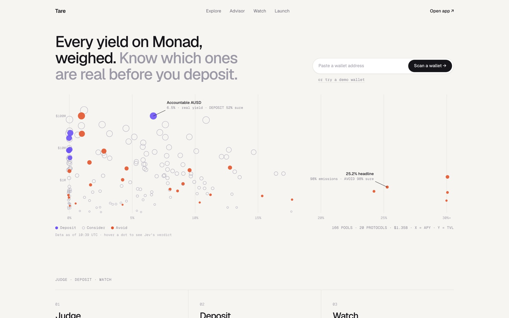

# Tare

**A public, graded risk feed for Monad yield, and a Guardian that acts on it.**

Tare watches yield vaults on Monad. Jev (TypeSafe's System One model) judges each position: hold, exit or move, and how sure it is. Every verdict is posted onchain to `TareRiskOracle`, with a hash of exactly what Jev was shown. When a verdict says exit, **anyone** can call `GuardianV2.exit()` and the contract pulls opted-in users out, paying only to their own wallets. A day later, **anyone** can grade the verdict onchain against what the vault actually did. The result is a track record Tare can't edit or flatter.

Tare is a risk primitive: one oracle, one keeperless exit contract and one public scorecard that wallets, vault curators and treasuries can read or build on.

In trading terms, Guardian is a **stop-loss order for yield**: you set the rule once (how sure the warning must be, how fresh), and the order fires on a risk signal instead of a price, executed by anyone, settled to you in one Monad block. And Tare answers the question every parametric product has to face, *who is accountable when the oracle is wrong?*, with a public grading window and a scorecard it can't edit.



## Live

| What | Where |
|---|---|
| App | https://tarefi.xyz (Testnet / Mainnet switch in the header) |
| Public API | https://api.tarefi.xyz (index of routes at `/`, health at `/v1/health`) |
| What Jev saw, per verdict | `https://ledger.tarefi.xyz/state/{stateHash}.json` (public R2) |
| Repo | https://github.com/0xGanadhish/tare |
| Networks | Monad Mainnet (143): real USDC vaults. Monad Testnet (10143): mirror vaults with a stress demo. |

### For judges: how to check it

1. **Mainnet, no wallet needed.** Open the **[mainnet Ledger](https://tarefi.xyz/app/ledger?network=mainnet)**. Every verdict links to its oracle transaction, the state document Jev was shown, and its grade once the window closes. Mainnet verdicts are graded 24 hours after posting, after a 1-hour sampling window, so the first ones (posted 13 Oct, 11:55 IST) are graded from **14 Oct, about 13:00 IST**, and new grades land every day after that. The page reads the chain live, so it fills in on its own. The same data is at [`/v1/verdicts?network=mainnet`](https://api.tarefi.xyz/v1/verdicts?network=mainnet) and [`/v1/ledger/score?network=mainnet`](https://api.tarefi.xyz/v1/ledger/score?network=mainnet). To see a full grading cycle right away, switch the Ledger to **Testnet**, where the window is 1 hour.
2. **Mainnet, with a wallet.** Deposit a few USDC into Clearstar or August through **Advisor**, and turn on Guardian in the protect step that follows. Your exit rule is stored in `GuardianV2`, shows up in **Watch**, and can be turned off at any time.
3. **Testnet stress demo.** Switch to **Testnet**, click **Get test USDC**, deposit into a mirror vault and turn Guardian on. The mirror vaults copy a real vault's APY and let an operator push utilization up, so you can watch Jev post an EXIT verdict and the Guardian exit land in seconds. The demo controls need the operator's `ADMIN_TOKEN`, so the demo video shows a full stress run.
4. **Read the code paths that matter:** [`TareRiskOracle.sol`](contracts/src/TareRiskOracle.sol), [`GuardianV2.sol`](contracts/src/GuardianV2.sol), the adapters in [`contracts/src/adapters/`](contracts/src/adapters), and the backend's [`crons.ts`](backend/src/crons.ts) (sampling and grading) and [`watcher.ts`](backend/src/watcher.ts) (verdicts).

## How it works

```
 vault state ──► Jev (typed questions) ──► fixed rules in code ──► TareRiskOracle.post(vault, verdict, confidence, risk, stateHash)
                                                                          │
                                         ┌────────────────────────────────┤
                                         ▼                                ▼
                         GuardianV2.exit(vault, owner)            24 h later: sample() … resolve()
                         anyone may call; the contract            anyone may call; graded on the worst
                         checks the verdict and the               reading of share price, TVL and
                         owner's own rule; funds go               withdrawable liquidity
                         only to the owner                                │
                                                                          ▼
                                                                public Ledger + Brier score
```

**1. Verdicts.** A watcher per vault (a Cloudflare Durable Object) re-reads the vault every 30 s on mainnet, along with its hourly deposit and withdrawal flows from the indexer. When APY moves more than 0.5 points, utilization more than 5 points, or net outflows pass 10% of TVL over the last hour, Jev answers small typed questions: hold, exit or move, the chance you can't withdraw in full soon, the chance the yield collapses. Fixed rules in code turn those answers into a verdict. Jev never holds keys. The attester key posts the verdict onchain with `stateHash = keccak256(state document)`, and the state document is archived publicly, so anyone can check what Jev was shown.

**2. Keeperless exits.** `GuardianV2.exit(vault, owner)` is permissionless. It succeeds only when all of these hold, checked onchain:
- the vault is approved and the owner opted in with `enable(vault, minConfidence, maxAge)` (80–99% confidence, 1–60 minute freshness)
- the oracle's latest verdict on that vault is EXIT, at or above the owner's confidence, fresh, and posted after they opted in
- that verdict hasn't already been used to exit this owner

Assets are redeemed straight to the owner. Guardian never holds funds, and its admin can only approve vaults. Tare's backend calls `exit` within seconds of an EXIT verdict, but if Tare disappears, anyone else can.

**3. Grading.** After the resolve window (24 h on mainnet, 1 h on testnet), `resolve(id)` grades the verdict as adverse if any of these happened:
- share price fell more than 0.5%
- TVL fell more than 20%
- withdrawable liquidity fell under 5% of TVL
- the vault's views stopped answering

On mainnet, `sample(id)` can be called by anyone for one hour before grading, and the contract keeps the **worst** reading. A flash loan can only flatter its own transaction, so it can't lift a grade. Tare's backend samples every verdict twice, once when the window opens and once at a random moment it doesn't announce, so faking a healthy vault means keeping the money in for the whole hour. The Ledger turns grades into a Brier score and a hit rate per confidence band, and publishes them whether or not it flatters Tare.

**Withdrawable liquidity** is read through stateless adapters, one per vault type: Euler Earn counts what its strategies will actually pay out; Morpho Vault V2 counts idle cash plus what its liquidity market can return. Both ignore USDC donated straight to the vault, and neither can revert once registered (a revert would stall verdicts on that vault).

## Why Monad

Posting a verdict onchain costs about 0.05–0.06 MON on Monad, and sampling it twice and grading it about 0.07–0.10 MON more, paid by a separate executor wallet (Monad bills the full gas limit; measured against the live mainnet contracts). So a vault re-judged ten times a day stays fully public, every verdict posted, sampled and graded, for about 1.2–1.6 MON a day. Speed matters as much as cost: a protective exit races everyone else heading for the door, and the Blitz demo's Guardian exit confirmed in 2.2 s ([tx](https://testnet.monadvision.com/tx/0x22d5ffad10ba384975565640eca72fa39de616538283f436405162b43172abb4)). Monad makes "post everything, grade everything, let anyone act" cheap enough to be the default.

## Mainnet vaults

A mainnet vault is watched only if it passes all five rules: its asset is USDC; it's an Euler Earn or Morpho V2 vault (so an adapter can read its real liquidity); TVL of at least $1M; Guardian fully exits a 1,000 USDC position on a mainnet fork; and the adapter's reading is above 0 and no more than TVL.

| Vault | Type | Address |
|---|---|---|
| Clearstar Earn USDC | Euler Earn | [`0xE1BcA19baA63894D374578320551633320436523`](https://monadvision.com/address/0xE1BcA19baA63894D374578320551633320436523) |
| August USDC V2 | Morpho Vault V2 | [`0x80017bF0f793EBbE9679Cd61ff0e395B62CAbB59`](https://monadvision.com/address/0x80017bF0f793EBbE9679Cd61ff0e395B62CAbB59) |

Left out on purpose: Hyperithm USDC Apex (3.7% withdrawable, under the 5% floor, so every HOLD would grade adverse) and Saturn USDC (about $9 of idle cash and no liquidity market, so Guardian couldn't get anyone out). The in-app Docs tab explains both.

## Contracts

### Monad Mainnet (chain 143)

Source verified on Sourcify (shown on MonadVision). Deployed 13 Oct 2026 at block 112,967,056 ([oracle creation tx](https://monadvision.com/tx/0x5108b95d778394184ba29d991096208dd0d6fa16b4f6ceaa5f71a7e170a2a06f)).

| Contract | Address |
|---|---|
| TareRiskOracle (24 h grading window + 1 h sampling) | [`0x6c1eCe33Cc745d57Ec1A6EDB64573A90863e96D8`](https://monadvision.com/address/0x6c1eCe33Cc745d57Ec1A6EDB64573A90863e96D8) |
| GuardianV2 | [`0x2C78895d94f9A61e569eF679838108cb2Ec50f23`](https://monadvision.com/address/0x2C78895d94f9A61e569eF679838108cb2Ec50f23) |
| EulerEarnAdapter (Clearstar) | [`0x738f70aa6f4a6e2882641a42a3C19a44D7D04FB3`](https://monadvision.com/address/0x738f70aa6f4a6e2882641a42a3C19a44D7D04FB3) |
| MorphoV2Adapter (August) | [`0xF766CF9770A0ECb7808d4Fb19816742A0E0Bc4a7`](https://monadvision.com/address/0xF766CF9770A0ECb7808d4Fb19816742A0E0Bc4a7) |
| USDC (Circle) | `0x754704Bc059F8C67012fEd69BC8A327a5aafb603` |

### Monad Testnet (chain 10143), source verified

| Contract | Address |
|---|---|
| TareRiskOracle | [`0x9fE598a6D7BD9073ea871FB80E2B05Aa58768405`](https://testnet.monadvision.com/address/0x9fE598a6D7BD9073ea871FB80E2B05Aa58768405) |
| GuardianV2 | [`0x470D2Ee28054C250238Da0E2fD66D69438BEDf8c`](https://testnet.monadvision.com/address/0x470D2Ee28054C250238Da0E2fD66D69438BEDf8c) |
| MirrorAdapter | [`0x117F6d23786A9d373c3ac26E29dc20618EF9c8de`](https://testnet.monadvision.com/address/0x117F6d23786A9d373c3ac26E29dc20618EF9c8de) |
| MockUSDC (6 decimals, open mint) | [`0xd535a4068265b383976d92718e3E650b5183b6Ab`](https://testnet.monadvision.com/address/0xd535a4068265b383976d92718e3E650b5183b6Ab) |
| MirrorVault: Clearstar USDC · Euler | [`0x7504b078d1F2b90fb9fcAf3d22753311013EA0aC`](https://testnet.monadvision.com/address/0x7504b078d1F2b90fb9fcAf3d22753311013EA0aC) |
| MirrorVault: K3 Capital Earn · Euler | [`0x7c1c54fD8ae0bEC3a9D15A60DF4F0777298F6609`](https://testnet.monadvision.com/address/0x7c1c54fD8ae0bEC3a9D15A60DF4F0777298F6609) |
| MirrorVault: August USDC v2 · Morpho | [`0x92b4e57F3DD6450C65a45d081D0e97d5f5f9aA43`](https://testnet.monadvision.com/address/0x92b4e57F3DD6450C65a45d081D0e97d5f5f9aA43) |
| MirrorVault: Anemoy Apollo Credit · Centrifuge | [`0x0c12De3767B22573b96510aCf67B5D298990B227`](https://testnet.monadvision.com/address/0x0c12De3767B22573b96510aCf67B5D298990B227) |
| LaunchFactory | [`0x6Ef1ca2A0c8B918429b78d8E9C8A8fc5F9970F1F`](https://testnet.monadvision.com/address/0x6Ef1ca2A0c8B918429b78d8E9C8A8fc5F9970F1F) |

<details>
<summary>Blitz v1 contracts (keeper-gated Guardian, kept for history)</summary>

The v1 Guardian (`0x0F22A6b6E5FB8bda0e85e5034DEaC069c8d5e8DF`) could only be called by one operator key. It's deployed at the same address on testnet and mainnet, alongside the same four mirror vaults. On mainnet the demo token is `tareUSD` (`0xd535a4068265b383976d92718e3E650b5183b6Ab`) so it can never be mistaken for USDC, and the mainnet LaunchFactory is `0xf7FECFF40b2851bc205A5F234Fd6EcA379a867A1`. v2 replaces the keeper with onchain rules and adds the oracle.

</details>

## Security

- **Funds only go to the owner.** `GuardianV2.exit` redeems to `owner`, and the admin can only approve vaults. There is no withdraw, sweep or upgrade path.
- **Fail safe.** If Jev, the backend or an RPC is down, no verdict is posted and nobody can exit anyone. Exits get harder, never easier.
- **One wallet per role per network.** Deployer/owner, attester and executor are separate keys on mainnet and testnet, held only in Cloudflare secrets or a git-ignored `.env`.
- **Grades can't be flattered.** Worst-sample grading, plus fork tests on mainnet that flash-borrow from Morpho to inflate a sample and check the stored worst reading doesn't move.
- **Honest limits.** The attester is a single key, so a compromised attester could post a fresh EXIT and trigger exits. Those exits still pay only the owner and only for users who opted in at that confidence. The Docs tab lists the rest.

## Use Tare in your own product

The full reference, with signatures, grading rules, API responses and GraphQL queries, is in [docs/developers.md](docs/developers.md).

- **Read the oracle.** `latest(vault)` gives the newest verdict id; `getPost(id)` gives verdict, confidence, risk and `stateHash`; `getResolution(id)` gives the grade. Events: `VerdictPosted`, `VerdictSampled`, `VerdictResolved`.
- **Read the API.** `GET /v1/vaults/{network}/{vault}/latest`, `/v1/verdicts`, `/v1/ledger/score`, `/v1/pools`. Read-only, no key.
- **Index it.** The Envio indexer in [`indexer/`](indexer) exposes verdicts, protections, exits and large withdrawals over GraphQL.
- **Protect your own users.** Any wallet can show "protect this position" by calling `GuardianV2.enable` and approving shares; exits then happen without any keeper you run.
- **Run your own Tare.** Everything here is MIT. Deploy the contracts with your own attester, point the backend at your own judge, and you have your own public, graded feed. Next on the roadmap: let other judges post to the same oracle under their own attester, each with its own scorecard.

## Run it

### In 2 minutes, no keys

Prerequisites: Node 22+ and pnpm 10.

```bash
git clone https://github.com/0xGanadhish/tare.git
cd tare
pnpm install
DATA_SOURCE=fixtures pnpm dev
```

Open http://localhost:3000. Fixture mode serves bundled pool, verdict and wallet-scan snapshots, so browsing, Pulse and the idle scan work with no keys or network.

### Full stack

| Part | Folder | Run |
|---|---|---|
| App (Next.js, Vercel) | `.` | `cp .env.example .env`, then `pnpm dev` |
| Backend (Cloudflare Worker: D1, R2, Queues, Durable Objects) | `backend/` | secrets in `backend/.dev.vars`, then `pnpm -C backend dev` |
| Indexer (Envio HyperIndex) | `indexer/` | see [`indexer/README.md`](indexer/README.md) |
| Contracts (Foundry) | `contracts/` | `forge test`; deploy with `script/DeployV2.s.sol` |

Backend secrets (set with `wrangler secret put`, never committed): `TYPESAFE_API_KEY`, `ATTESTER_KEY_TESTNET`, `EXECUTOR_KEY_TESTNET`, `ATTESTER_KEY_MAINNET`, `EXECUTOR_KEY_MAINNET`, `ADMIN_TOKEN`, `ENVIO_GRAPHQL_URL`, and optionally `ALCHEMY_URL_TESTNET` / `ALCHEMY_URL_MAINNET`. App variables are listed in `.env.example`; only `NEXT_PUBLIC_*` values reach the browser.

Deploy the v2 contracts (writes `shared/addresses.<network>.json`):

```bash
cd contracts
ATTESTER=<attester address> WRITE_ADDRESSES=true forge script script/DeployV2.s.sol --rpc-url <rpc> --broadcast --private-key <deployer key>
```

Drop `--broadcast` for a dry run. On mainnet the script checks each vault's adapter kind before registering it.

## Architecture

- **Contracts** (`contracts/`): `TareRiskOracle`, `GuardianV2`, liquidity adapters (`EulerEarnAdapter`, `MorphoV2Adapter`, `MirrorAdapter`), plus the Blitz contracts (MirrorVault, MockUSDC, LaunchFactory, CurveToken).
- **Backend** (`backend/`, `api.tarefi.xyz`): a pool scan cron (DeFiLlama, every 10 minutes, verdicts in D1); one `VaultWatcher` Durable Object per vault; a `TxSender` Durable Object per key that serializes nonces; an exit queue (Cloudflare Queues, with a dead-letter queue); a resolver cron that samples and grades verdicts every minute; state documents archived to R2.
- **Indexer** (`indexer/`): Envio HyperIndex over both networks: verdicts, protections, exits, hourly vault flows and large withdrawals. Hourly flows feed back into what Jev is shown.
- **App** (`app/`, `components/`): Explore, Pulse, Advisor, Watch, Ledger, Docs, idle Scan; on testnet also the faucet, demo controls and Launch, which never appear on mainnet. Wallet transactions go straight from the browser via wagmi and viem.
- **Shared** (`shared/`): network config, addresses, ABIs, and the verdict and scoring code every part uses.

## Tests

```bash
pnpm test                          # app and shared (294)
pnpm -C backend test               # Cloudflare Worker, in workerd (110)
pnpm -C indexer test               # simulated events (15)
cd contracts && forge test         # unit and fuzz (114), plus 7 mainnet fork tests with --fork-url https://rpc.monad.xyz
```

## Traction

- **3rd place at Monad Blitz Pune V3** (10 Oct 2026), built solo in a day. That build is the foundation listed below.
- The testnet ledger has been posting and grading verdicts around the clock since 11 Oct, from Cloudflare rather than a laptop.
- Mainnet since 13 Oct: two real USDC vaults (about $14M TVL) watched, every verdict posted onchain, and every one graded 24 hours later on the [mainnet Ledger](https://tarefi.xyz/app/ledger?network=mainnet).

## Business model

Tare takes no fees today; the contracts are fee-free. The plan, strongest first:

| Stream | How | Why it fits |
|---|---|---|
| Risk API and feed | Graded verdicts and exit signals for wallets, curators, DAO treasuries and lending markets listing vaults | The scorecard is public, so buyers can check the product before paying |
| Guardian performance fee | 10% of the yield earned while a position is protected, charged only on profit | Tare earns only when the user earns |
| Routing and referral fees | Advisor deposits through protocol referral and curator rev-share programs | No cost to the user |
| Launchpad fee | 0.5–1% on bonding-curve trades, plus a share of reserve yield | Launch already ships on testnet |

## What was built when

- **Monad Blitz Pune V3 (10 Oct 2026), up to commit `7f90aaf`:** Explore, Pulse, Advisor, idle Scan, Launch, Jev pool verdicts, the mirror vaults, the keeper-gated Guardian v1 and the local worker (`worker/`).
- **Monad Metropolis (11–13 Oct 2026), every commit after `7f90aaf`:** `TareRiskOracle` with permissionless, worst-sample grading; keeperless `GuardianV2`; liquidity adapters for Euler Earn and Morpho V2 with mainnet fork tests; the Cloudflare backend; the Envio indexer; the Testnet / Mainnet switch, Watch v2, Ledger and Docs pages; the mainnet deploy.

## AI disclosure

- **Claude Code** (Anthropic) was used throughout as a coding assistant: writing code and tests, reviewing contracts for security, and drafting docs. Product decisions, vault selection, wallets, keys and every deploy were the author's.
- **Jev** (TypeSafe's System One model) is part of the product: it answers the typed questions behind every pool and position verdict at runtime. It never holds keys; fixed rules in code and contracts decide what happens.

## Built with

Monad, Jev by TypeSafe, Envio HyperIndex, Cloudflare Workers (D1, R2, Queues, Durable Objects), DeFiLlama, Euler, Morpho, Next.js, wagmi and viem, Foundry, OpenZeppelin, monskills.

## Team

Solo: [0xGanadhish](https://github.com/0xGanadhish).

## License

[MIT](LICENSE)
